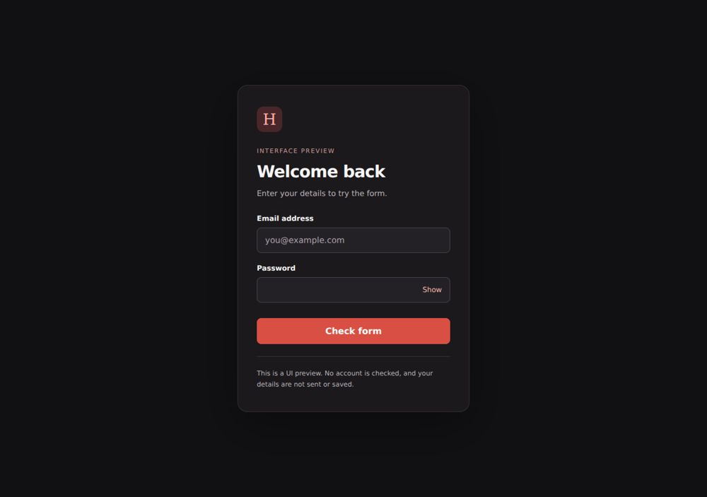

# Login form UI



A responsive login form interface using HTML, CSS, native JavaScript and local CSS.

## Run locally

Requires Python 3 for the optional static server. From this repository folder:

```bash
python -m http.server 8000
```

Open http://localhost:8000. No deployment is required.

## Repository structure

- `index.html` — form markup
- `styles.css` — appearance
- `script.js` — client-side demo form validation
- `docs/` — import provenance and review notes

## Scope and dependencies

This is form validation only. It does not verify credentials or create an authenticated session. Password visibility can be toggled accessibly. There is no password reset or phone-login flow. The interface has no CDN dependency.

## Validation

Local HTML/CSS asset references and JavaScript syntax are checked during the import. See `docs/VALIDATION.md` for the actual results and limits. CI is defined in `.github/workflows/quality.yml`.

## Source preservation

All original project files were imported in a separate Git commit before changes. `docs/ORIGINAL_FILES.sha256` lists the archive file checksums. Existing images, fonts and notices are retained. No repository-wide license grant has been added.
